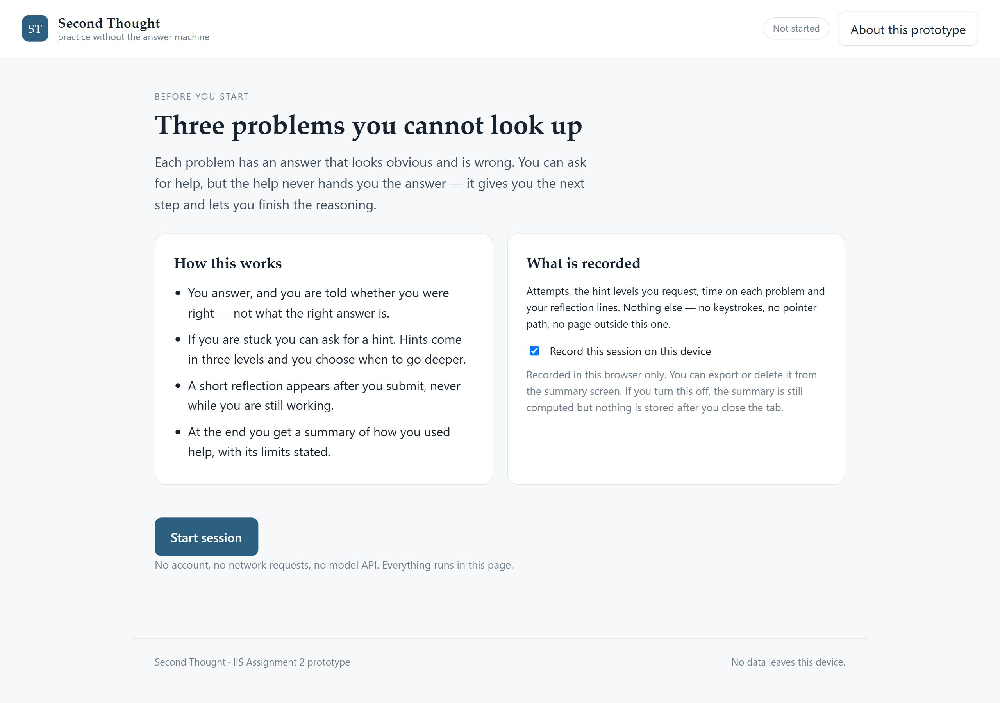

# Second Thought

A practice environment for problems you cannot ask ChatGPT to solve. Three problems, a three-level hint ladder that never gives the answer, and a session summary that states what it cannot tell you.



**README prose word count: 885** (paragraphs and bullets only; headings, code blocks and image lines are excluded).

## What it is

Students who use ChatGPT for homework often cannot say whether they could have done the problem alone. Asking them is unreliable — self-reported reliance is what Stojanov et al. (2024) measured, and it does not predict unaided performance. Second Thought measures the thing directly: it presents problems whose obvious answer is wrong, records how much help the learner asks for, and reports that pattern instead of a self-assessment.

The design decision that matters is that help is a ladder, not an answer. Level 1 restates the question, level 2 names the relationship to set up, level 3 does one step with the learner. Level 3 still leaves the final move to them. The interface never displays a solution.

## Project status

**Works.** The full loop runs in one page: contract screen with a logging toggle, three problems with answer checking, the hint ladder, a reflection prompt after each problem, a summary with a limits statement, per-problem detail, JSON export and delete.

**Simulated.** The hint selector is a rule set — attempt count, time on task, and whether the answer matched the item's lure. It is not a language model. Hint text is authored per problem, so the "adaptation" is the choice of level and the reason shown to the learner ("because your answer matched the trap this problem is built around"), not generated prose.

**Not built.** Model-generated hints, a tutor dashboard, and a delayed retest. The retest is the one that matters: without it the summary can describe one sitting but cannot say anything about retention, and the limits statement says so.

## Technology stack

Plain HTML, CSS and JavaScript. No framework, no build step, no dependencies, no network calls. Session state lives in `localStorage`; the export is a client-side Blob download. This was a deliberate choice: the assignment asks for a walkthrough a reader can follow, and a single page that opens from a folder is easier to inspect than a stack that needs installing.

No AI model runs inside the product. The hint selector is a rule set, so the same session reproduces the same choices offline and nothing is sent anywhere. The choice still undecided is whether a model should rewrite the hint text at a level the rules have already chosen — the level decision would stay with the rules, because the level is what the study measures. The AI tools used to build and document the project, and what each contributed, are listed under AI assistance below.

## Run it

```bash
cd a2-second-thought
python -m http.server 8770
# open http://127.0.0.1:8770
```

Any static server works. Opening `index.html` directly also runs, but `localStorage` behaves inconsistently on `file://`, so use the server.

## Development record

- **Scope cut.** The first sketch scored free-text justifications with a keyword matcher. It was removed: the matcher rewarded phrasing, not reasoning, and a wrong score would have been worse than no score. Justifications are now only stored, not judged.
- **Hint escalation bug.** During the storyboard walkthrough, "I need more than this" re-showed level 2 instead of moving to level 3, because the selector recomputed the same rule. Fixed by making the deeper action bypass the rule and take `deepest + 1`. This is the kind of fault that only appears when you walk the interaction rather than the code.
- **Reflection timing.** The prompt was originally on a five-minute timer. It now opens when a problem is submitted. A timer interrupts mid-reasoning and changes the behaviour being measured — the same point the Week 7 guideline review made about timing services on context rather than on a clock.
- **Summary wording.** The first limits sentence ran two clauses together without a full stop. Corrected after reading the rendered page rather than the source.

All four changes were made while walking the prototype, before the repository existed, so they share the first commit (`dbc7bf2`) instead of having one each. Commits after it (`8dc6ad6` onwards) fix the report build: figure and caption separation, appendix pagination, and the word-count statement.

## AI assistance

I used an AI assistant (Claude, via WorkBuddy) for three things: drafting the rule set and hint text, writing the first version of the CSS, and drafting this README. I specified the interaction model, the three problems and the wording of the limits statement, and I checked every suggestion by running the page and walking the flow. The hint escalation bug and the reflection-timing change came out of that checking, not out of the generated code. The report's argument, the guideline mapping and the claim about what the summary can support are mine.

## Files

```
index.html                 single page, four views
assets/app.js              session state, hint ladder, summary
assets/tasks.js            problem bank: answers, lures, hint text
assets/styles.css
docs/system-diagram.svg    components and flows
docs/storyboard-1..3.svg   three interaction walkthroughs
docs/screenshots/          captures used in the report
tools/                     scripts used to capture screenshots and render diagrams
```

## Additional files

The report is in this repository at `docs/A2_Project_Report_3129594.docx`. Open it in Word, or use the PDF of the same file in the submission ZIP.

`A2_3129594.zip` contains the report (`.docx` and `.pdf`) and a copy of this repository. Nothing in it is unavailable here — it is there so the report can be read without cloning. The figures it embeds are the same files under `docs/` and `docs/screenshots/`.

## Data and privacy

Nothing leaves the device. The contract screen lets the learner turn recording off before starting; the summary screen can export the record as JSON or delete it. No keystrokes, pointer paths or page content outside this app are captured — only attempts, hint levels, timings and the reflection lines the learner writes.
